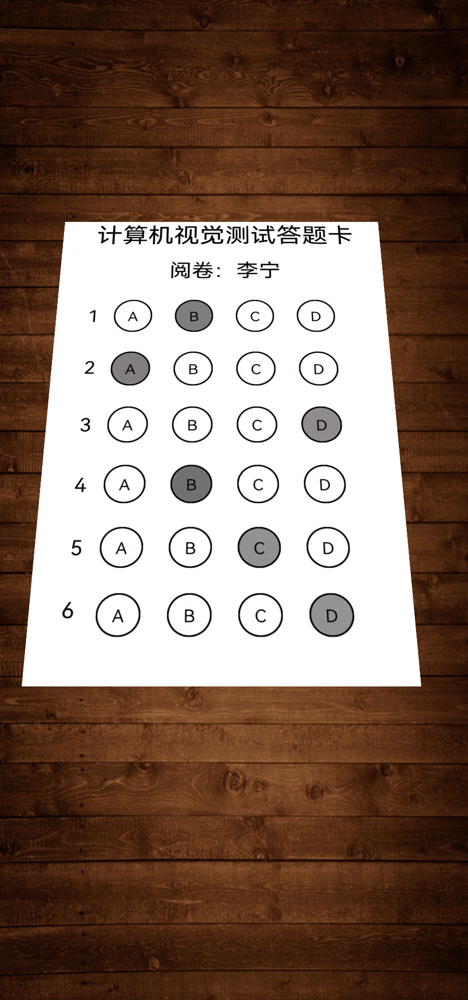
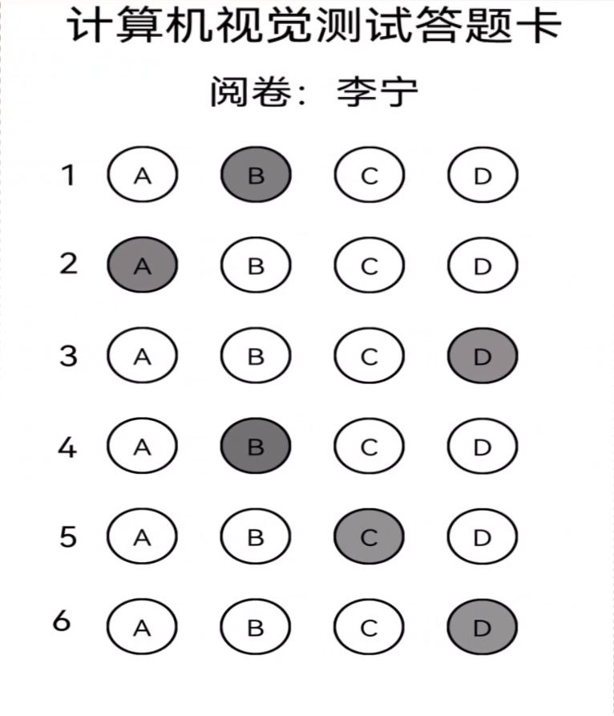
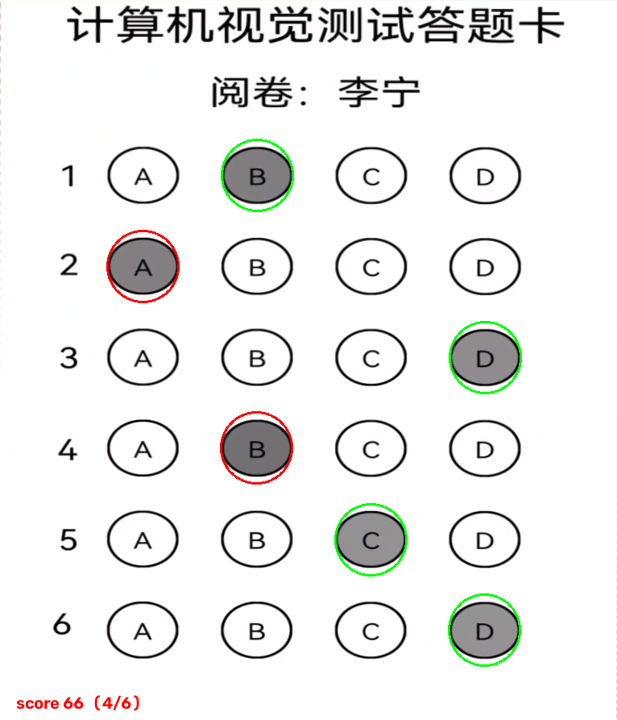

# 答题卡识别系统

C++ / OpenCV 的答题卡自动阅卷程序。输入一张手机拍的答题卡照片，输出每题选项、对错和分数。

**在 500 张随机扰动合成样本上，逐题准确率 100%（3000/3000），整卡全对率 100%（500/500）。**

---

## 效果

输入 → 校正 → 识别（卡片斜放、桌面木纹背景）：

| 输入 | 透视校正后 | 识别结果 |
|---|---|---|
|  |  |  |

绿圈=答对，红圈=答错，左上角是分数。

7 个扰动维度全部覆盖：角度 ±15°、缩放 0.45~1.10、平移 ±8%、
填涂灰度 60~180、模糊 σ 0~1.6、噪声 σ 0~6、亮度 alpha 0.8~1.2 / beta ±30。

---

## 快速开始

```powershell
# 编译（需要 VS2022 + OpenCV 5.0）
.\scripts\build.ps1
.\scripts\build.ps1 -Tools          # 连样本生成器一起编

# 跑一遍固定回归（7 张样本）
.\scripts\run_regression.ps1

# 跑压力测试（N 张随机扰动图）
.\scripts\run_stress.ps1 -Count 200 -Regen
```

> 如果报 `无法加载文件 ......ps1，未对文件进行数字签名`，是 PowerShell 执行策略拦的，不是脚本问题：
> `powershell -ExecutionPolicy Bypass -File .\scripts\build.ps1`，或
> `Set-ExecutionPolicy -Scope CurrentUser RemoteSigned`。

## CLI 用法

```powershell
answersheet_cli.exe --image <path> [--out result.json] [--debug-dir dir] [--gui]
```

| 参数 | 说明 |
|---|---|
| `--image` | 输入图片（必填） |
| `--out` | 结果 JSON 输出路径 |
| `--debug-dir` | 输出校正图、二值图等中间结果 |
| `--gui` | 显示窗口（默认关闭，可无头批处理） |

输出示例：

```json
{
  "found": true,
  "answers": ["B", "A", "D", "B", "C", "D"],
  "correct_flags": [true, false, true, false, true, true],
  "correct": 4,
  "total": 6,
  "score": 66
}
```

退出码：`0` 成功识别，`2` 参数错误，`3` 图片读不了，`4` 未找到答题卡。

---

## 处理流程

```
读图 → 灰度 → 找卡片四边形 → 透视校正 → 二值化 → 筛气泡
     → 按行分组 → 4 位置一致性校验 → 灰度对比度判填涂 → 比对答案
```

### 找卡片：亮纸掩膜，不是 Canny

答题卡是画面里唯一一大片高亮区域。Otsu 一分割，纸就是白色的一个连通块，
轮廓天然闭合。Canny 只作为备选。

> 为什么不用 Canny 做主路线：背景木纹的水平边经常和卡片边在闭运算后连成一条线，
> 最大轮廓就从卡片"漏"到背景上（实测凸度从 0.99 掉到 0.63）。

凸包 + `approxPolyDP` 拿四个角，`getPerspectiveTransform` + `warpPerspective` 校正。

### 判填涂：灰度对比度，不是二值化计数

```cpp
// 气泡内部均值 vs 周围纸面均值
double fill = (paperMean - innerMean) / paperMean;
```

分子分母都随光照同比缩放，所以光照不均、曝光变化都不影响。

> 原判据 `countNonZero/maskArea` 的致命问题：OTSU 是整张卡求一个阈值，
> 被黑色标题字拉低，浅铅笔（灰度 150~178）涂的根本过不了阈值。

阈值从数据里读出来的，不是拍的：

```
实心填涂（1110 个）：min 0.0942  p1 0.1451  p50 0.4723  max 0.8132
空白气泡（  90 个）：全部 0.0000
```

阈值取 **0.05**——比最浅的真实填涂低 47%，又明显高于空白。

---

## 测试

### 三层测试

| 层 | 命令 | 作用 |
|---|---|---|
| 固定回归 | `run_regression.ps1` | 7 张样本，行为没变 |
| 压力测试 | `run_stress.ps1 -Count 200 -Regen` | 随机扰动，量化准确率 |
| 单图诊断 | `run_stress.ps1` / `diag.exe` | 打印各阶段中间结果 |

### 压力测试结果

| 种子 | 张数 | 逐题准确率 | 整卡全对 | 定位失败 | 空白识别 |
|---|---|---|---|---|---|
| 20261109 | 200 | 100.00% | 100.00% | 0 | 100% |
| 12345 | 100 | 100.00% | 100.00% | 0 | 100% |
| 777001 | 100 | 100.00% | 100.00% | 0 | 100% |
| 20261110 | 100 | 100.00% | 100.00% | 0 | 100% |
| **合计** | **500** | **3000/3000** | **500/500** | **0** | **100%** |

五个扰动维度单独看每一档都是 100%，不是靠"大部分简单、少数困难"平均出来的。

### 优化过程

| 阶段 | 逐题准确率 | 定位失败 |
|---|---|---|
| 原始算法 | 63.71% | 11 / 40 |
| 修填涂判据 | 80.67% | 3 / 40 |
| 修生成器 bug | 93.67% | 3 / 40 |
| 换亮纸掩膜找卡 + 标定阈值（最后） | **100.00%** | **0** |

每一步改动的根因、实测证据、被否掉的方案，都记在 [data/BASELINE.md](data/BASELINE.md)。

---

## 目录结构

```
Answer sheet/
├── Answer sheet.cpp          # 原始单文件版本（保留，ExcludedFromBuild）
├── Answer sheet.cli.cpp      # CLI 版本，实际编译这个
├── tools/
│   ├── gen_samples.cpp       # 合成 7 张固定样本 + expected.json
│   ├── gen_stress.cpp        # 合成 N 张随机扰动样本 + manifest.json
│   └── diag.cpp              # 单图诊断
├── data/
│   ├── BASELINE.md           # 缺陷记录：根因 / 实测证据 / 修复 / 被否方案
│   ├── samples/              # 7 张固定样本 + 真值
│   └── stress/               # 压力样本（gitignore）
└── scripts/
    ├── build.ps1
    ├── run_regression.ps1
    └── run_stress.ps1
```

---

## 依赖

- Visual Studio 2022 (v143)，C++17
- OpenCV 5.0.0，`E:\Opencv\opencv\build`（`scripts/build.ps1` 顶部可改）

> OpenCV 5 的坑：`contourArea` / `boundingRect` 已移出 imgproc，
> 需要 `#include <opencv2/geometry.hpp>`，否则 `error C3861`。

## 已验证

在干净目录克隆本仓库后，从零执行 `build.ps1 -Tools` → `run_regression.ps1` → `run_stress.ps1 -Regen`
全部通过（回归 7/7，压力测试 4 个种子合计 500 张 100%）。`data/stress/` 不入库，
用 `-Regen` 现场生成即可。

---

## 已知局限

1. **只在合成图上验证过**。合成图是真实卡片照片 + 程序化 warp + 扰动，
   缺真实手机拍摄的透视畸变、滚动快门、纸张褶皱、反光斑。
2. **固定版式**。6 题 4 选项，`ANSWER` 表硬编码，题数/选项数/布局不可配。
3. **只有文件输入**。相机、GigE、视频流都没有。
4. **Debug 单张 134ms**，离产线节拍（通常 < 50ms）还有距离，需要 Release + 优化。
5. **没有失败重试**。定位失败直接返回 4，不尝试备用预处理。
